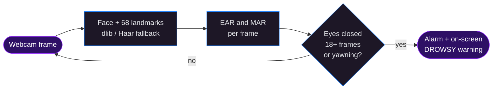

<!-- styled:v2 -->
<div align="center">


**Real-time computer vision that watches a driver's eyes and mouth through a webcam and sounds an alarm before fatigue turns into an accident.**

<p>
  
  
  
  
  
</p>

<p>
  <a href="#overview">Overview</a> ·
  <a href="#how-it-works">How it works</a> ·
  <a href="#key-features">Key features</a> ·
  <a href="#tech-stack">Tech stack</a> ·
  <a href="#project-structure">Project structure</a> ·
  <a href="#getting-started">Getting started</a>
</p>

</div>

---

## Overview

Drivers on long trips often don't notice their own drowsiness in time. This system tracks facial landmarks on every camera frame, measures how open the eyes are (eye aspect ratio, EAR) and whether the driver is yawning (mouth aspect ratio, MAR), and raises an audible warning when the eyes stay closed for too long. It runs as a desktop app or as a Streamlit web app that can be installed like a native app (PWA).

## How it works



| Setting | Value | Meaning |
|:--|:--|:--|
| `EAR_THRESHOLD` | 0.27 | Below this, the eye counts as closed |
| `CONSEC_CLOSED_FRAMES` | 18 | About 0.6 s at 30 fps before a drowsiness warning |
| `MAR_YAWN_THRESHOLD` | 0.55 | Above this, the mouth counts as yawning |
| `YAWN_CONSEC_FRAMES` | 12 | A sustained yawn also triggers the warning |

Thresholds live in `drowsiness_core.py` and can be tuned per driver and camera.

## Key features

- Real-time eye tracking with the standard 6-point EAR formula
- Yawn detection from mouth landmarks
- Audible alarm and colour-coded on-screen overlays
- Falls back to Haar cascades if dlib is not installed
- Lane detection module (`lanedetection.py`)
- Streamlit web dashboard with live camera through WebRTC
- Installable PWA with a service worker and offline page
- Session analysis script and automated tests

## Tech stack

| Area | Tools |
|:--|:--|
| Computer vision | OpenCV, dlib (68-point landmarks), SciPy, NumPy |
| Web app | Streamlit, streamlit-webrtc, PyAV |
| PWA | Web manifest, service worker, generated icons (Pillow) |
| Alarm | winsound on Windows, playsound on Linux and macOS |

## Project structure

```
├── main.py                 # Desktop entry point
├── drowsiness_core.py      # Landmarks, EAR/MAR and alert logic
├── blinkDetect.py          # Blink detection
├── lanedetection.py        # Lane detection module
├── Sesssion_analysis.py    # Session statistics
├── streamlit_app/          # Web dashboard and PWA (manifest, sw.js, icons)
├── models/                 # Place the dlib landmark model here
└── tests/                  # Automated tests
```

## Getting started

```bash
python -m venv .venv
.venv\Scripts\activate          # Windows  (Linux/macOS: source .venv/bin/activate)
pip install -r requirements.txt
```

Download the 68-point landmark model from [dlib.net](https://dlib.net/files/shape_predictor_68_face_landmarks.dat.bz2) (about 100 MB, not stored in this repo), extract it and put `shape_predictor_68_face_landmarks.dat` in `models/`.

```bash
python main.py                                   # desktop app
cd streamlit_app && streamlit run streamlit_app_pwa.py   # web app / PWA on http://localhost:8501
```

If dlib fails to install on Windows, run `pip install cmake` first. See [DEPLOYMENT.md](DEPLOYMENT.md) for Streamlit Cloud and other hosting options.

---

<div align="center">

**Built by [Ch Muhammad Samiullah](https://github.com/samiullah156-creator)** · AI Automation Engineer and Full-Stack Developer at [Lexvaxa](https://lexvaxa.com)

<a href="https://github.com/samiullah156-creator"></a>
<a href="https://lexvaxa.com/contact"></a>
<a href="https://www.linkedin.com/in/sami-lexvaxa/"></a>

<sub>⭐ Star this repo if you found it useful</sub>

</div>


